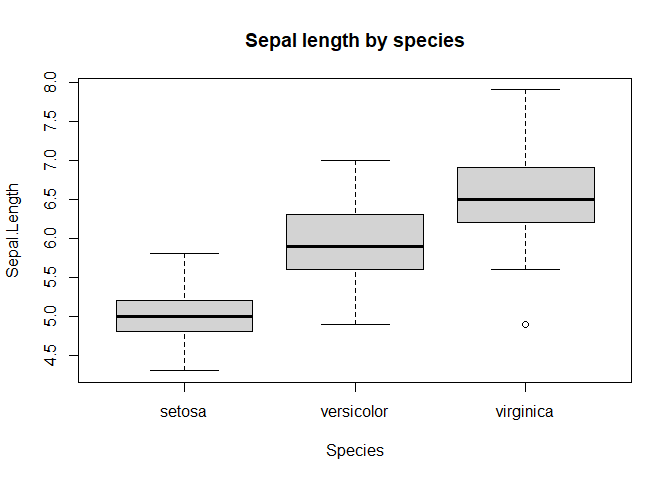
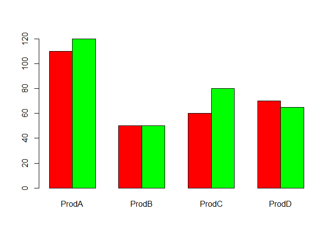
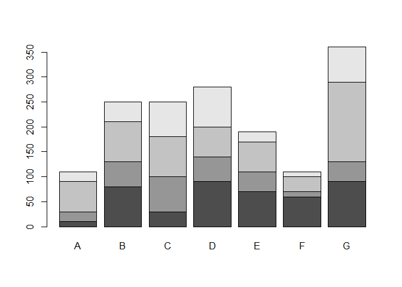
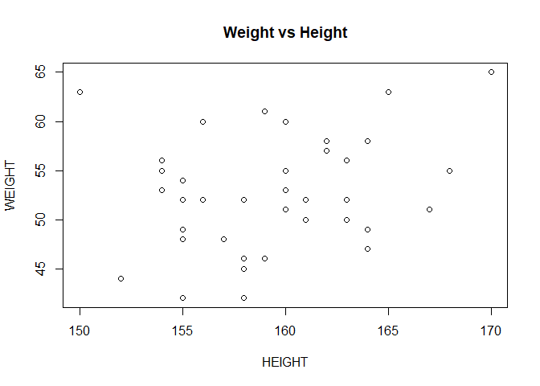
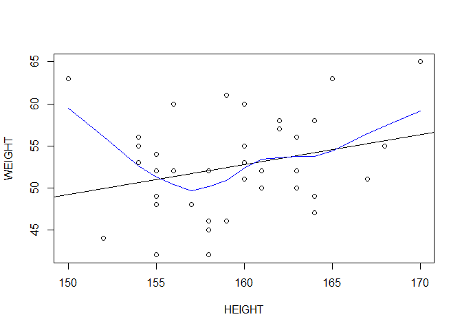
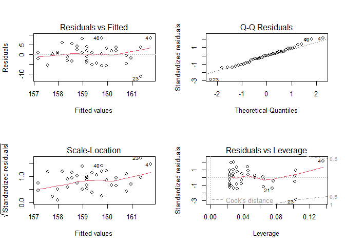
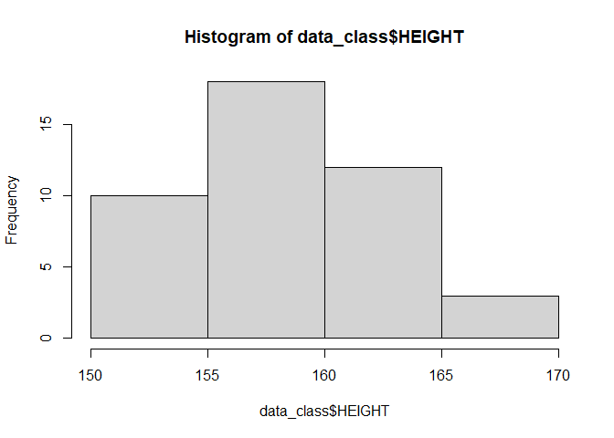
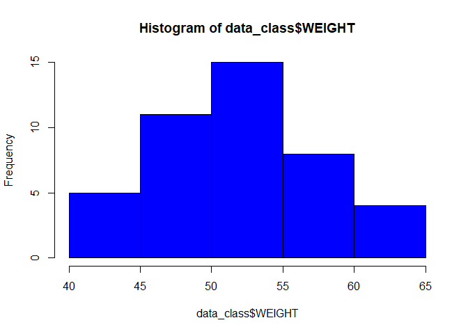

Assignment 2: Practicing the R codes the lecturer had shared
================
Ayinebyona Prosper
2026-10-31

## Introduction

In this assignment I practice the R codes from class: vectors, matrices,
lists, factors, missing values, data frames, importing data, summary
statistics, graphs, linear models, data management, dates and
subsetting.

## 1. R as a calculator

``` r
5 + 3
```

    ## [1] 8

``` r
20 / 4
```

    ## [1] 5

``` r
2^5
```

    ## [1] 32

``` r
sqrt(81)
```

    ## [1] 9

## 2. Vectors

### Numeric

``` r
x <- c(0.5, 0.6)
age <- c(20, 35, 32, 29)
summary(age)
```

    ##    Min. 1st Qu.  Median    Mean 3rd Qu.    Max. 
    ##   20.00   26.75   30.50   29.00   32.75   35.00

``` r
mean(age)
```

    ## [1] 29

### Logical

``` r
x <- c(TRUE, FALSE)
x <- c(T, F)
x
```

    ## [1]  TRUE FALSE

### Character

``` r
x <- c("a", "b", "c")
class <- c("M", "F", "F", "M")
class
```

    ## [1] "M" "F" "F" "M"

### Integer

``` r
x <- 9:29
x
```

    ##  [1]  9 10 11 12 13 14 15 16 17 18 19 20 21 22 23 24 25 26 27 28 29

### Complex

``` r
x <- c(1 + 0i, 2 + 4i)
x
```

    ## [1] 1+0i 2+4i

## 3. Matrix

``` r
(x <- matrix(1:6, nrow = 2, ncol = 3))
```

    ##      [,1] [,2] [,3]
    ## [1,]    1    3    5
    ## [2,]    2    4    6

``` r
(y <- matrix(1:6, nrow = 3, ncol = 2))
```

    ##      [,1] [,2]
    ## [1,]    1    4
    ## [2,]    2    5
    ## [3,]    3    6

``` r
# matrix multiplication
x %*% y
```

    ##      [,1] [,2]
    ## [1,]   22   49
    ## [2,]   28   64

## 4. List

A list can keep different types of data together.

``` r
(x <- list(1, "a", TRUE, 1 + 4i))
```

    ## [[1]]
    ## [1] 1
    ## 
    ## [[2]]
    ## [1] "a"
    ## 
    ## [[3]]
    ## [1] TRUE
    ## 
    ## [[4]]
    ## [1] 1+4i

## 5. Factor

``` r
x <- factor(c("yes", "yes", "no", "yes", "no"))
x
```

    ## [1] yes yes no  yes no 
    ## Levels: no yes

``` r
levels(x)
```

    ## [1] "no"  "yes"

## 6. Missing values

``` r
x <- c(1, 2, NA, 10, 3)
is.na(x)
```

    ## [1] FALSE FALSE  TRUE FALSE FALSE

``` r
# keep only the values that are not missing
bad <- is.na(x)
x[!bad]
```

    ## [1]  1  2 10  3

Keeping only the cases with no missing value in two vectors:

``` r
x <- c(1, 2, NA, 4, NA, 5)
y <- c("a", "b", NA, "d", NA, "f")
good <- complete.cases(x, y)
good
```

    ## [1]  TRUE  TRUE FALSE  TRUE FALSE  TRUE

``` r
x[good]
```

    ## [1] 1 2 4 5

``` r
y[good]
```

    ## [1] "a" "b" "d" "f"

## 7. Coercion

If a vector has numbers and logical values, R changes TRUE to 1 and
FALSE to 0.

``` r
sum(c(TRUE, TRUE, FALSE, FALSE, FALSE))
```

    ## [1] 2

## 8. Creating a data frame

``` r
studentID <- c(1, 2, 3, 4, 5)
math_score <- c(12, 17, 10, 9, NA)
gender <- c("M", "F", "M", "M", "F")
it_score <- c(13, 18, 11, 10, 19)

scoredata <- data.frame(studentID, gender, math_score, it_score)
scoredata
```

    ##   studentID gender math_score it_score
    ## 1         1      M         12       13
    ## 2         2      F         17       18
    ## 3         3      M         10       11
    ## 4         4      M          9       10
    ## 5         5      F         NA       19

To open the data in a viewer window (I don’t run this when knitting):

``` r
View(scoredata)
```

## 9. Creating data from the keyboard

This opens an editor to type the data, so it only works when run by
hand.

``` r
data_class2 <- data.frame(height = numeric(0), weight = numeric(0), bmi = numeric(0))
data_class2 <- edit(data_class2)
```

## 10. Importing the class data

The file `class_data.txt` is in the same folder as this R Markdown file.

``` r
data_class <- read.table("class_data.txt", header = TRUE)

variable.names(data_class)
```

    ## [1] "HEIGHT" "WEIGHT"

``` r
head(data_class)
```

    ##   HEIGHT WEIGHT
    ## 1    161     50
    ## 2    155     49
    ## 3    158     42
    ## 4    170     65
    ## 5    160     60
    ## 6    156     52

``` r
tail(data_class)
```

    ##    HEIGHT WEIGHT
    ## 38    164     47
    ## 39    163     52
    ## 40    168     55
    ## 41    157     48
    ## 42    164     58
    ## 43    154     55

``` r
data_class[10:20, ]
```

    ##    HEIGHT WEIGHT
    ## 10    167     51
    ## 11    160     60
    ## 12    155     42
    ## 13    154     53
    ## 14    155     48
    ## 15    157     48
    ## 16    157     48
    ## 17    160     53
    ## 18    158     52
    ## 19    160     51
    ## 20    160     53

``` r
summary(data_class$WEIGHT)
```

    ##    Min. 1st Qu.  Median    Mean 3rd Qu.    Max. 
    ##   42.00   48.00   52.00   52.47   56.00   65.00

``` r
length(data_class$WEIGHT)
```

    ## [1] 43

## 11. Built-in data

`data()` shows the list of datasets that come with R. Here I use
`airquality`.

``` r
data("airquality")
variable.names(airquality)
```

    ## [1] "Ozone"   "Solar.R" "Wind"    "Temp"    "Month"   "Day"

``` r
str(airquality)
```

    ## 'data.frame':    153 obs. of  6 variables:
    ##  $ Ozone  : int  41 36 12 18 NA 28 23 19 8 NA ...
    ##  $ Solar.R: int  190 118 149 313 NA NA 299 99 19 194 ...
    ##  $ Wind   : num  7.4 8 12.6 11.5 14.3 14.9 8.6 13.8 20.1 8.6 ...
    ##  $ Temp   : int  67 72 74 62 56 66 65 59 61 69 ...
    ##  $ Month  : int  5 5 5 5 5 5 5 5 5 5 ...
    ##  $ Day    : int  1 2 3 4 5 6 7 8 9 10 ...

``` r
head(airquality, 5)
```

    ##   Ozone Solar.R Wind Temp Month Day
    ## 1    41     190  7.4   67     5   1
    ## 2    36     118  8.0   72     5   2
    ## 3    12     149 12.6   74     5   3
    ## 4    18     313 11.5   62     5   4
    ## 5    NA      NA 14.3   56     5   5

## 12. Summary statistics

``` r
summary(data_class)
```

    ##      HEIGHT          WEIGHT     
    ##  Min.   :150.0   Min.   :42.00  
    ##  1st Qu.:156.0   1st Qu.:48.00  
    ##  Median :159.0   Median :52.00  
    ##  Mean   :159.3   Mean   :52.47  
    ##  3rd Qu.:162.0   3rd Qu.:56.00  
    ##  Max.   :170.0   Max.   :65.00

``` r
str(data_class)
```

    ## 'data.frame':    43 obs. of  2 variables:
    ##  $ HEIGHT: int  161 155 158 170 160 156 162 158 158 167 ...
    ##  $ WEIGHT: int  50 49 42 65 60 52 58 46 45 51 ...

``` r
# mean and standard deviation of each column
apply(data_class, 2, mean)
```

    ##    HEIGHT    WEIGHT 
    ## 159.25581  52.46512

``` r
apply(data_class, 2, sd)
```

    ##   HEIGHT   WEIGHT 
    ## 4.304444 5.750150

``` r
c(Mean = mean(data_class$HEIGHT), SD = sd(data_class$HEIGHT))
```

    ##       Mean         SD 
    ## 159.255814   4.304444

``` r
c(Mean = mean(data_class$WEIGHT), SD = sd(data_class$WEIGHT))
```

    ##     Mean       SD 
    ## 52.46512  5.75015

## 13. Categorical and continuous variable

I compare petal length between the three species in the `iris` data.

``` r
data("iris")
head(iris)
```

    ##   Sepal.Length Sepal.Width Petal.Length Petal.Width Species
    ## 1          5.1         3.5          1.4         0.2  setosa
    ## 2          4.9         3.0          1.4         0.2  setosa
    ## 3          4.7         3.2          1.3         0.2  setosa
    ## 4          4.6         3.1          1.5         0.2  setosa
    ## 5          5.0         3.6          1.4         0.2  setosa
    ## 6          5.4         3.9          1.7         0.4  setosa

``` r
mean(iris$Petal.Length)
```

    ## [1] 3.758

``` r
mean(iris$Petal.Length[iris$Species == "setosa"])
```

    ## [1] 1.462

``` r
mean(iris$Petal.Length[iris$Species == "versicolor"])
```

    ## [1] 4.26

``` r
mean(iris$Petal.Length[iris$Species == "virginica"])
```

    ## [1] 5.552

``` r
# shortcut
by(iris$Petal.Length, iris$Species, mean)
```

    ## iris$Species: setosa
    ## [1] 1.462
    ## ------------------------------------------------------------ 
    ## iris$Species: versicolor
    ## [1] 4.26
    ## ------------------------------------------------------------ 
    ## iris$Species: virginica
    ## [1] 5.552

``` r
by(iris$Petal.Length, iris$Species, sd)
```

    ## iris$Species: setosa
    ## [1] 0.173664
    ## ------------------------------------------------------------ 
    ## iris$Species: versicolor
    ## [1] 0.469911
    ## ------------------------------------------------------------ 
    ## iris$Species: virginica
    ## [1] 0.5518947

``` r
by(iris$Petal.Length, iris$Species, summary)
```

    ## iris$Species: setosa
    ##    Min. 1st Qu.  Median    Mean 3rd Qu.    Max. 
    ##   1.000   1.400   1.500   1.462   1.575   1.900 
    ## ------------------------------------------------------------ 
    ## iris$Species: versicolor
    ##    Min. 1st Qu.  Median    Mean 3rd Qu.    Max. 
    ##    3.00    4.00    4.35    4.26    4.60    5.10 
    ## ------------------------------------------------------------ 
    ## iris$Species: virginica
    ##    Min. 1st Qu.  Median    Mean 3rd Qu.    Max. 
    ##   4.500   5.100   5.550   5.552   5.875   6.900

Box plot:

``` r
boxplot(Sepal.Length ~ Species, data = iris,
        main = "Sepal length by species")
```

<!-- -->

## 14. Two categorical variables

``` r
ucba <- data.frame(UCBAdmissions)
head(ucba)
```

    ##      Admit Gender Dept Freq
    ## 1 Admitted   Male    A  512
    ## 2 Rejected   Male    A  313
    ## 3 Admitted Female    A   89
    ## 4 Rejected Female    A   19
    ## 5 Admitted   Male    B  353
    ## 6 Rejected   Male    B  207

``` r
(cross <- xtabs(Freq ~ Gender + Admit, data = ucba))
```

    ##         Admit
    ## Gender   Admitted Rejected
    ##   Male       1198     1493
    ##   Female      557     1278

``` r
prop.table(cross, 1)
```

    ##         Admit
    ## Gender    Admitted  Rejected
    ##   Male   0.4451877 0.5548123
    ##   Female 0.3035422 0.6964578

Overall, a smaller proportion of females were admitted.

### Simpson’s paradox

When I look at one department only (department F), the result changes
and females have a slightly higher admission rate.

``` r
cross2 <- xtabs(Freq ~ Gender + Admit, data = ucba[ucba$Dept == "F", ])
prop.table(cross2, 1)
```

    ##         Admit
    ## Gender     Admitted   Rejected
    ##   Male   0.05898123 0.94101877
    ##   Female 0.07038123 0.92961877

## 15. Bar charts

``` r
dat <- read.table(text = "ProdA ProdB ProdC ProdD
1 110 50 60 70
2 120 50 80 65", header = TRUE)

barplot(as.matrix(dat), beside = TRUE, col = c("red", "green"))
```

<!-- -->

``` r
dat <- read.table(text = "A B C D E F G
1 10 80 30 90 70 60 90
2 20 50 70 50 40 10 40
3 60 80 80 60 60 30 160
4 20 40 70 80 20 10 70", header = TRUE)

barplot(as.matrix(dat))
```

<!-- -->

## 16. Scatter plot and correlation

``` r
plot(WEIGHT ~ HEIGHT, data = data_class, main = "Weight vs Height")
```

<!-- -->

``` r
cor(data_class$HEIGHT, data_class$WEIGHT)
```

    ## [1] 0.2663495

## 17. Linear model

``` r
plot(WEIGHT ~ HEIGHT, data = data_class)
abline(lm(WEIGHT ~ HEIGHT, data = data_class)$coefficients)
lines(lowess(data_class$HEIGHT, data_class$WEIGHT), col = "blue")
```

<!-- -->

``` r
data_lm <- lm(HEIGHT ~ WEIGHT, data = data_class)
summary(data_lm)
```

    ## 
    ## Call:
    ## lm(formula = HEIGHT ~ WEIGHT, data = data_class)
    ## 
    ## Residuals:
    ##      Min       1Q   Median       3Q      Max 
    ## -11.3563  -2.6662   0.2326   2.0378   8.2449 
    ## 
    ## Coefficients:
    ##             Estimate Std. Error t value Pr(>|t|)    
    ## (Intercept) 148.7951     5.9466  25.022   <2e-16 ***
    ## WEIGHT        0.1994     0.1127   1.769   0.0843 .  
    ## ---
    ## Signif. codes:  0 '***' 0.001 '**' 0.01 '*' 0.05 '.' 0.1 ' ' 1
    ## 
    ## Residual standard error: 4.199 on 41 degrees of freedom
    ## Multiple R-squared:  0.07094,    Adjusted R-squared:  0.04828 
    ## F-statistic: 3.131 on 1 and 41 DF,  p-value: 0.08427

Diagnostic plots of the model:

``` r
par(mfrow = c(2, 2))
plot(data_lm)
```

<!-- -->

``` r
par(mfrow = c(1, 1))
```

Histograms:

``` r
hist(data_class$HEIGHT)
```

<!-- -->

``` r
hist(data_class$WEIGHT, col = "blue")
```

<!-- -->

## 18. Data management

### Creating a new variable (BMI)

``` r
BMI <- round(data_class$WEIGHT / (data_class$HEIGHT / 100)^2, digits = 2)

new_data_class <- cbind(data_class, BMI)
head(new_data_class, 5)
```

    ##   HEIGHT WEIGHT   BMI
    ## 1    161     50 19.29
    ## 2    155     49 20.40
    ## 3    158     42 16.82
    ## 4    170     65 22.49
    ## 5    160     60 23.44

``` r
tail(new_data_class, 10)
```

    ##    HEIGHT WEIGHT   BMI
    ## 34    165     63 23.14
    ## 35    156     60 24.65
    ## 36    163     56 21.08
    ## 37    155     52 21.64
    ## 38    164     47 17.47
    ## 39    163     52 19.57
    ## 40    168     55 19.49
    ## 41    157     48 19.47
    ## 42    164     58 21.56
    ## 43    154     55 23.19

### Summary of BMI

``` r
summary(BMI)
```

    ##    Min. 1st Qu.  Median    Mean 3rd Qu.    Max. 
    ##   16.82   19.16   20.40   20.70   22.23   28.00

``` r
stem(BMI, scale = 2)
```

    ## 
    ##   The decimal point is at the |
    ## 
    ##   16 | 8
    ##   17 | 55
    ##   18 | 0022348
    ##   19 | 03555569
    ##   20 | 0114778
    ##   21 | 145667
    ##   22 | 1455
    ##   23 | 12446
    ##   24 | 17
    ##   25 | 
    ##   26 | 
    ##   27 | 
    ##   28 | 0

## 19. Dates

``` r
today <- Sys.Date()
format(today, format = "%B %d %Y")
```

    ## [1] "October 31 2026"

``` r
format(today, format = "%A")
```

    ## [1] "Saturday"

``` r
# number of days since my date of birth
dob <- as.Date("2000-05-15")
difftime(today, dob, units = "days")
```

    ## Time difference of 9665 days

``` r
startdate <- as.Date("2004-02-13")
enddate <- as.Date("2011-01-22")
enddate - startdate
```

    ## Time difference of 2535 days

## 20. Leadership data

Five managers answered five questions (1 = strongly disagree to 5 =
strongly agree). An age of 99 means the age is missing.

``` r
manager <- c(1, 2, 3, 4, 5)
country <- c("US", "US", "UK", "UK", "UK")
gender <- c("M", "F", "F", "M", "F")
age <- c(32, 45, 25, 39, 99)
q1 <- c(5, 3, 3, 3, 2)
q2 <- c(4, 5, 5, 3, 2)
q3 <- c(5, 2, 5, 4, 1)
q4 <- c(5, 5, 5, NA, 2)
q5 <- c(5, 5, 2, NA, 1)

leadership <- data.frame(manager, country, gender, age, q1, q2, q3, q4, q5)
str(leadership)
```

    ## 'data.frame':    5 obs. of  9 variables:
    ##  $ manager: num  1 2 3 4 5
    ##  $ country: chr  "US" "US" "UK" "UK" ...
    ##  $ gender : chr  "M" "F" "F" "M" ...
    ##  $ age    : num  32 45 25 39 99
    ##  $ q1     : num  5 3 3 3 2
    ##  $ q2     : num  4 5 5 3 2
    ##  $ q3     : num  5 2 5 4 1
    ##  $ q4     : num  5 5 5 NA 2
    ##  $ q5     : num  5 5 2 NA 1

``` r
names(leadership)
```

    ## [1] "manager" "country" "gender"  "age"     "q1"      "q2"      "q3"     
    ## [8] "q4"      "q5"

### Missing values and age groups

``` r
leadership$age[leadership$age == 99] <- NA

leadership$agecat[leadership$age > 75] <- "Elder"
leadership$agecat[leadership$age >= 35 & leadership$age <= 75] <- "Middle Aged"
leadership$agecat[leadership$age < 35] <- "Young"

leadership
```

    ##   manager country gender age q1 q2 q3 q4 q5      agecat
    ## 1       1      US      M  32  5  4  5  5  5       Young
    ## 2       2      US      F  45  3  5  2  5  5 Middle Aged
    ## 3       3      UK      F  25  3  5  5  5  2       Young
    ## 4       4      UK      M  39  3  3  4 NA NA Middle Aged
    ## 5       5      UK      F  NA  2  2  1  2  1        <NA>

### Removing rows with missing values

``` r
is.na(leadership[, 5:9])
```

    ##         q1    q2    q3    q4    q5
    ## [1,] FALSE FALSE FALSE FALSE FALSE
    ## [2,] FALSE FALSE FALSE FALSE FALSE
    ## [3,] FALSE FALSE FALSE FALSE FALSE
    ## [4,] FALSE FALSE FALSE  TRUE  TRUE
    ## [5,] FALSE FALSE FALSE FALSE FALSE

``` r
newdata <- na.omit(leadership)
newdata
```

    ##   manager country gender age q1 q2 q3 q4 q5      agecat
    ## 1       1      US      M  32  5  4  5  5  5       Young
    ## 2       2      US      F  45  3  5  2  5  5 Middle Aged
    ## 3       3      UK      F  25  3  5  5  5  2       Young

### Sorting

``` r
order(leadership$age)
```

    ## [1] 3 1 4 2 5

``` r
newdata2 <- leadership[order(leadership$age), ]
newdata2
```

    ##   manager country gender age q1 q2 q3 q4 q5      agecat
    ## 3       3      UK      F  25  3  5  5  5  2       Young
    ## 1       1      US      M  32  5  4  5  5  5       Young
    ## 4       4      UK      M  39  3  3  4 NA NA Middle Aged
    ## 2       2      US      F  45  3  5  2  5  5 Middle Aged
    ## 5       5      UK      F  NA  2  2  1  2  1        <NA>

### Merging

I made a small salary table and merged it with the leadership data using
`manager`.

``` r
salary <- data.frame(manager = c(1, 2, 3, 4, 5),
                     salary = c(5200, 4800, 3900, 4500, 3100))

leadership_salary <- merge(leadership, salary, by = "manager")
leadership_salary
```

    ##   manager country gender age q1 q2 q3 q4 q5      agecat salary
    ## 1       1      US      M  32  5  4  5  5  5       Young   5200
    ## 2       2      US      F  45  3  5  2  5  5 Middle Aged   4800
    ## 3       3      UK      F  25  3  5  5  5  2       Young   3900
    ## 4       4      UK      M  39  3  3  4 NA NA Middle Aged   4500
    ## 5       5      UK      F  NA  2  2  1  2  1        <NA>   3100

Adding a new row with `rbind()` (both data frames must have the same
variables):

``` r
new_manager <- data.frame(manager = 6, country = "US", gender = "M", age = 41,
                          q1 = 4, q2 = 4, q3 = 3, q4 = 5, q5 = 4,
                          agecat = "Middle Aged")

leadership2 <- rbind(leadership, new_manager)
leadership2
```

    ##   manager country gender age q1 q2 q3 q4 q5      agecat
    ## 1       1      US      M  32  5  4  5  5  5       Young
    ## 2       2      US      F  45  3  5  2  5  5 Middle Aged
    ## 3       3      UK      F  25  3  5  5  5  2       Young
    ## 4       4      UK      M  39  3  3  4 NA NA Middle Aged
    ## 5       5      UK      F  NA  2  2  1  2  1        <NA>
    ## 6       6      US      M  41  4  4  3  5  4 Middle Aged

### Selecting variables and observations

``` r
# selecting the five questions
myvars <- c("q1", "q2", "q3", "q4", "q5")
(newdata3 <- leadership[myvars])
```

    ##   q1 q2 q3 q4 q5
    ## 1  5  4  5  5  5
    ## 2  3  5  2  5  5
    ## 3  3  5  5  5  2
    ## 4  3  3  4 NA NA
    ## 5  2  2  1  2  1

``` r
# dropping the first five columns
(newdata4 <- leadership[, -(1:5)])
```

    ##   q2 q3 q4 q5      agecat
    ## 1  4  5  5  5       Young
    ## 2  5  2  5  5 Middle Aged
    ## 3  5  5  5  2       Young
    ## 4  3  4 NA NA Middle Aged
    ## 5  2  1  2  1        <NA>

``` r
# one column in different ways
leadership[[4]]
```

    ## [1] 32 45 25 39 NA

``` r
leadership$age
```

    ## [1] 32 45 25 39 NA

``` r
# selecting rows 2, 4 and 5
(newdata6 <- leadership[c(2, 4, 5), ])
```

    ##   manager country gender age q1 q2 q3 q4 q5      agecat
    ## 2       2      US      F  45  3  5  2  5  5 Middle Aged
    ## 4       4      UK      M  39  3  3  4 NA NA Middle Aged
    ## 5       5      UK      F  NA  2  2  1  2  1        <NA>

``` r
# using subset()
(newdata7 <- subset(leadership, age >= 35 | age < 24, select = c(q1, q2, q3, q4, q5)))
```

    ##   q1 q2 q3 q4 q5
    ## 2  3  5  2  5  5
    ## 4  3  3  4 NA NA

``` r
# men older than 30
leadership[leadership$gender == "M" & leadership$age > 30, ]
```

    ##   manager country gender age q1 q2 q3 q4 q5      agecat
    ## 1       1      US      M  32  5  4  5  5  5       Young
    ## 4       4      UK      M  39  3  3  4 NA NA Middle Aged

## Conclusion

I practiced the basic data structures in R, imported data from a text
file and used built-in datasets. I also calculated summary statistics,
made graphs, fitted a linear model, created a new variable, worked with
dates, and handled missing values, sorting, merging and subsetting.
